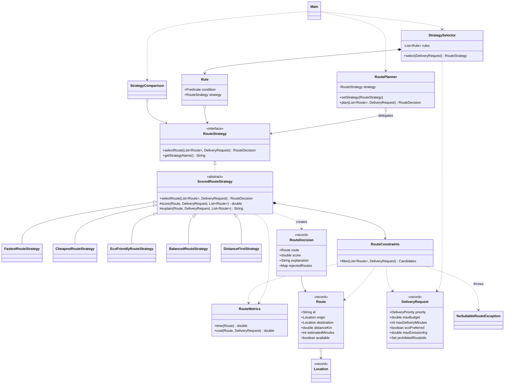
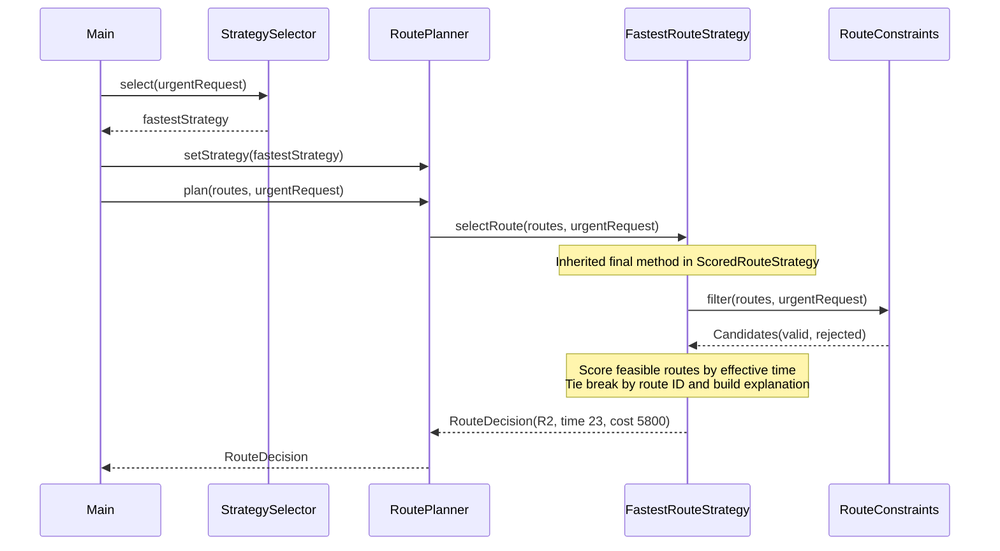

# Smart Delivery and Route Optimization Engine

Assignment 5 · Strategy Pattern · Java 17+ · Zhandos Zhaparkul · SE-2516

The application chooses a feasible delivery route using an interchangeable optimization algorithm. It includes eight candidate routes, five strategies, runtime switching, automatic selection, explanations, comparison mode and 32 JUnit 5 tests. All examples are simulated Astana logistics data; no map service is called.

## Run

Install JDK 17 or newer and Maven 3.9+. Open `pom.xml` in IntelliJ IDEA as a Maven project, select JDK 17+, then run `kz.aitu.delivery.Main`. Run `DeliveryTest` for tests.

```sh
mvn clean verify
java -jar target/smart-delivery-1.0.0.jar
```

A precompiled dependency-free demo is included for immediate use with Java 17+:

```sh
java -jar dist/smart-delivery-demo.jar
```

Without Maven, use `run.bat` on Windows or `sh run.sh` on Linux/macOS to compile and run with a JDK. Maven is required for the normal test command. The precompiled JAR contains application classes only.

## Architecture and design answers

**Problem solved.** Different deliveries optimize different objectives. Strategy isolates each algorithm behind one contract, so route planning does not accumulate mode-based branches.

**Context.** `RoutePlanner` stores a `RouteStrategy`, accepts replacements through `setStrategy`, and delegates `plan`. It has no algorithm, `instanceof`, or mode switch.

**Strategy interface.** `RouteStrategy.selectRoute` returns a `RouteDecision` rather than a bare `Route`. This deliberate interface improvement carries the selected route, raw strategy score, effective time, total cost, explanation and rejected-route reasons in one immutable result.

**Concrete strategies.** FastestRouteStrategy, CheapestRouteStrategy, EcoFriendlyRouteStrategy, BalancedRouteStrategy and DistanceFirstStrategy. They extend `ScoredRouteStrategy`, which centralizes filtering, deterministic selection and decision construction. The score and explanation are polymorphic hooks. This helper also uses a Template Method; it does not replace the Strategy relationship between the planner and interchangeable algorithms.

**Runtime switching.** The first section of `Main.main` creates one planner, plans with Fastest, and performs three explicit changes to Cheapest, Eco Friendly and Balanced. The JUnit test `runtimeSwitchesSamePlannerThreeTimes` independently verifies switching.

**Automatic selection.** `StrategySelector` applies an ordered immutable list of predicate/strategy rules supplied by the composition root `Main`. URGENT wins first; ECO or ecoPreferred wins next; ECONOMY follows; STANDARD uses Balanced. Thus URGENT + ecoPreferred remains Fastest, while ECONOMY + ecoPreferred uses Eco. An unmatched custom rule set throws explicitly. Strategy decides how to optimize; the selector decides which algorithm is appropriate. New conditions can be configured without editing the selector.

**Why Strategy rather than simple if/else.** Selection rules can contain business conditions, but the Context delegates to an interface. Each independently testable algorithm resides in its own class. Replacing a strategy does not modify the planner or other algorithms.

**How to add a strategy.** Extend `ScoredRouteStrategy` and implement name, score and explanation (or directly implement RouteStrategy if different mechanics are needed). Register the instance in `Main` for comparison and, optionally, in selector rules. The fifth-strategy commit adds one class and updates one registration line in Main; RoutePlanner changes: zero. Use `git show --stat` on that commit to verify.

**Strategy versus Bridge.** Strategy varies the algorithm used by a Context, usually at runtime. Bridge separates an abstraction hierarchy from an implementation hierarchy so both evolve independently. This project changes the route-selection behavior; it does not maintain two independent abstraction/implementation hierarchies as Bridge would.

**SOLID.** SRP: planner delegates, selector applies business rules, constraint component validates feasibility, strategies score routes. OCP: Distance First is added without changing the Context. DIP: RoutePlanner depends on RouteStrategy. All strategies honor the same selection/exception contract.

**Limitations.** The engine selects among supplied routes; it does not generate road paths or solve multi-stop vehicle routing. All candidates must represent the same origin/destination pair, a caller responsibility in this version. Traffic, weather and CO2 are estimates. Cost uses doubles rather than production-grade monetary decimals. Balanced recalculates min/max values during comparisons, so performance is quadratic and best suited to small candidate lists; cache per-request metrics for large inputs. Normalization depends on the feasible candidate set. Selector configuration and comparison registration are manual. Eco weights combine kg and km with business calibration and are not a scientific emissions model. There is no GUI, persistence or live traffic feed.

## Formulas and hard constraints

Units: distance km, time minutes, cost KZT, emissions kg CO2. Route `baseCost` is not the final cost.

- Effective time = estimatedMinutes + trafficPenaltyMinutes + weatherPenaltyMinutes.
- Total cost = baseCost + distanceKm × costPerKm + additionalFees + urgent surcharge. URGENT adds 1000 KZT; other priorities add zero. Cost and time are shared by scoring and hard constraints, preventing inconsistent feasibility checks.
- Fastest minimizes effective time, including both traffic and weather.
- Cheapest minimizes total cost.
- Eco minimizes carbonEmission × emissionWeight + distanceKm × distanceWeight; defaults 0.9 and 0.1. This formula belongs to the environmental Strategy because it expresses that algorithm's optimization policy, not general planner behavior.
- Balanced minimizes `t*N(time) + c*N(cost) + d*N(distance) + e*N(emissions)`. Defaults are `(0.40,0.30,0.10,0.20)`. Each weight must be finite and nonnegative; sum must equal one within 1e-9. `N(x)=(x-min)/(max-min)` across feasible candidates only. If max=min, the criterion contributes zero. One candidate therefore scores zero. Scores of different strategies have different units and must not be compared numerically across strategies.
- Distance First minimizes distanceKm after filtering.

Every strategy first rejects unavailable, prohibited, over-budget, over-deadline and over-emission-limit routes. Equality at a limit is accepted. All violations for a rejected route are recorded. No feasible route (including an empty input) throws `NoSuitableRouteException` carrying rejection diagnostics. Input validation rejects missing data, negative or nonfinite domain values, invalid coordinates, invalid weights and duplicate route IDs. Equal scores are resolved by lexicographic route ID, independent of input order.

## Verified example results

Same STANDARD request: budget 10000 KZT, deadline 90 minutes, no emission restriction.

| Strategy | Route | Effective time | Total cost | Distance | CO2 |
|---|---|---:|---:|---:|---:|
| Fastest | R2 | 23 min | 4800 KZT | 16 km | 4.5 kg |
| Cheapest | R5 | 45 min | 1580 KZT | 18 km | 2.5 kg |
| Eco Friendly | R4 | 43 min | 2210 KZT | 13 km | 0.4 kg |
| Balanced | R6 | 32 min | 3050 KZT | 9 km | 1.6 kg |
| Distance First | R6 | 32 min | 3050 KZT | 9 km | 1.6 kg |

With STANDARD budget reduced to 3500, Fastest changes from R2 to R6. With deadline 32 minutes, Eco changes from R4 to R6. URGENT selects R2 but total cost becomes 5800 because the surcharge applies. R7 is unavailable and never wins despite attractive metrics.

```text
Fastest -> R2 | time=23 min | cost=4800.00 KZT | distance=16.0 km | CO2=4.50 kg | score=23.0000
Reason: Minimum effective time: base 20 + traffic 2 + weather 1 = 23.0 min
Rejected R7: Route unavailable
```

Full captured output: [docs/console-output.txt](docs/console-output.txt).

## UML class diagram



## UML sequence diagram



Editable Mermaid sources are in `docs/`. GitHub renders these diagrams directly in the README.

## Verification

32 JUnit Jupiter tests were executed successfully with Java 17 and JUnit Platform Console 1.10.2 (Jupiter 5.10.2). The workspace provided a Java runtime without javac or Maven, so Eclipse ECJ 3.38.0 compiled the actual Java 17 sources, then the genuine JUnit runner executed the tests. Maven commands are provided for the standard local workflow; Maven itself was not executed in this workspace.

[Complete test output](test-output.txt) and [JUnit XML reports](docs/test-results/) are included. Tests cover all five algorithms, expected scores, three runtime switches, all selector mappings and precedence, rule extension, all hard constraints, budget and deadline changes, no route, empty input, invalid weights, comparisons and comparison failures, exact boundaries, zero-range normalization, tie-breaking, duplicate IDs, validation and defensive copies.

## Git history and submission

The archive contains a real local `.git` repository with staged development commits, plus `smart-delivery.bundle` for clients that hide dot folders. Commits record the work performed in this session; they are not presented as a week-long history. The fifth strategy was added after the original demo in its own commit. The archive has not been published to GitHub or submitted to Moodle.

From the extracted project root, create an empty **public** GitHub repository without a generated README, then run:

```sh
git log --oneline
git remote add origin https://github.com/YOUR_USERNAME/smart-delivery-assignment5.git
git push -u origin main
```

If `.git` was lost during extraction, restore from the bundle in the parent folder:

```sh
git clone smart-delivery.bundle restored-delivery
```

Submit the public repository URL and this README as the report according to Moodle instructions. Review the code and practice the individual defense and live modifications before submitting.
